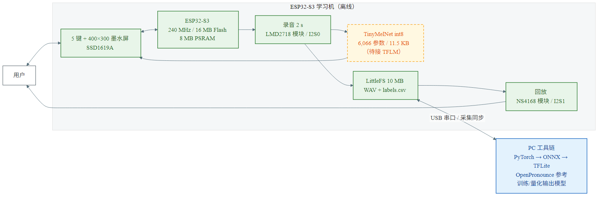
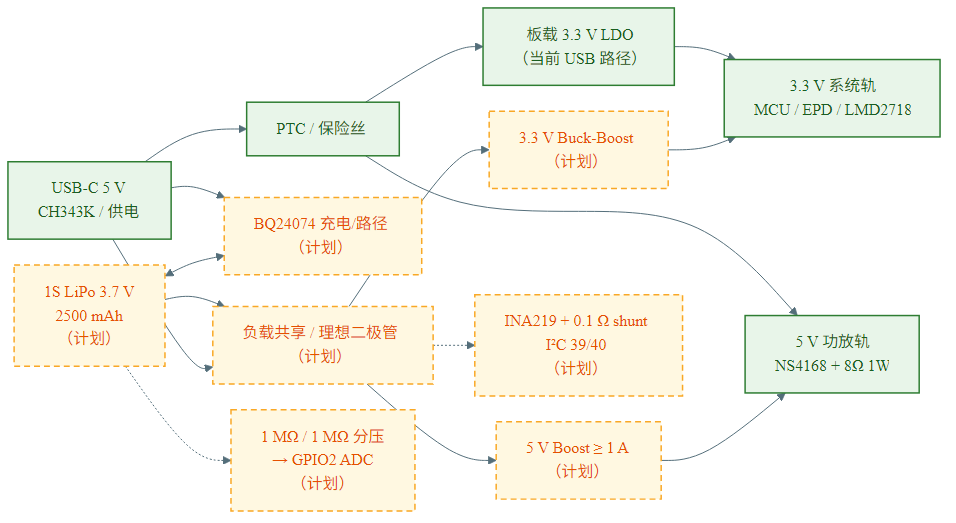
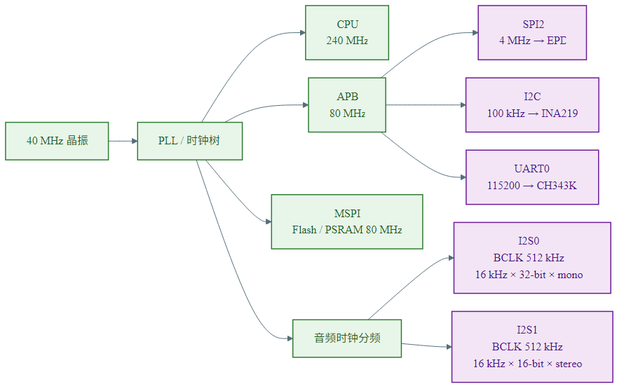
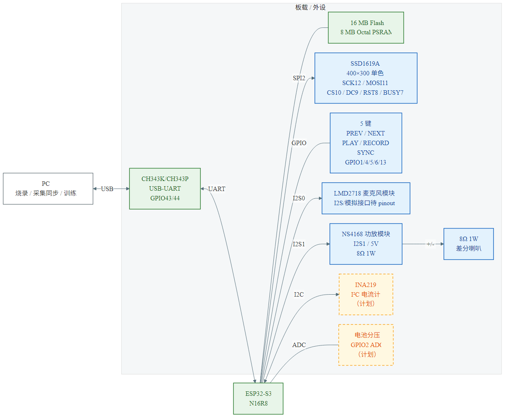

# 系统图表

本目录放四张工程图，源文件是 Mermaid（`src/*.mmd`），渲染产物在 `renders/`（SVG + PNG）。

> 2026-11 选型：MCU 为 ESP32-S3-WROOM-1-N16R8，音频为 **LMD2718 + NS4168 模块 + 8Ω 1W**，USB-UART 目标 **CH343K**。音频模块具体引脚未定，图中标为“待 pinout”。

## 图例

| 样式 | 含义 |
| --- | --- |
| 绿色实线 | 已实现/已实测 |
| 蓝色实线 | 外设/接口 |
| 橙色虚线 | 计划中/未接 |
| 灰色箭头 | 数据/电源/信号流 |

## 1. 系统总体框图



- 源文件：[`src/system-block.mmd`](src/system-block.mmd)
- SVG：[`renders/system-block.svg`](renders/system-block.svg)
- 说明：设备端离线运行；TinyMelNet 是计划接入 TFLM 的模型，虚线表示尚未进固件。
- 音频已定为 LMD2718 + NS4168 模块，具体接口待厂商 pinout。

## 2. 电源树



- 源文件：[`src/power-tree.mmd`](src/power-tree.mmd)
- SVG：[`renders/power-tree.svg`](renders/power-tree.svg)
- 实线：当前 USB 供电路径；虚线：电池/充电/升压/INA219 计划路径。
- `TP4056` 需要带保护电芯和负载共享；`INA219` 只测量，不充电。

## 3. 时钟树



- 源文件：[`src/clock-tree.mmd`](src/clock-tree.mmd)
- SVG：[`renders/clock-tree.svg`](renders/clock-tree.svg)
- 这是板级时钟分配示意，不是 EDA 的 clock-tree synthesis 结果。
- I2S0：16 kHz × 32-bit × mono = 512 kHz BCLK；I2S1：16 kHz × 16-bit × stereo = 512 kHz BCLK。

## 4. 设备拓扑



- 源文件：[`src/device-topology.mmd`](src/device-topology.mmd)
- SVG：[`renders/device-topology.svg`](renders/device-topology.svg)
- 包含实际 GPIO 分配；INA219 和电池分压是计划项。
- 更完整的排针/strapping 说明见 [`../board_pinmap.md`](../board_pinmap.md)。

## 重新渲染

依赖 Node.js + Mermaid CLI：

```powershell
npx -y @mermaid-js/mermaid-cli@11.12.0 `
  -i docs/diagrams/src/system-block.mmd `
  -o docs/diagrams/renders/system-block.svg `
  -b white -w 2200
```

PNG 把输出后缀改成 `.png`，建议 `-w 2600`。

> 修改图后同时更新 `.mmd`、`.svg`、`.png`，避免源文件和图片不一致。
