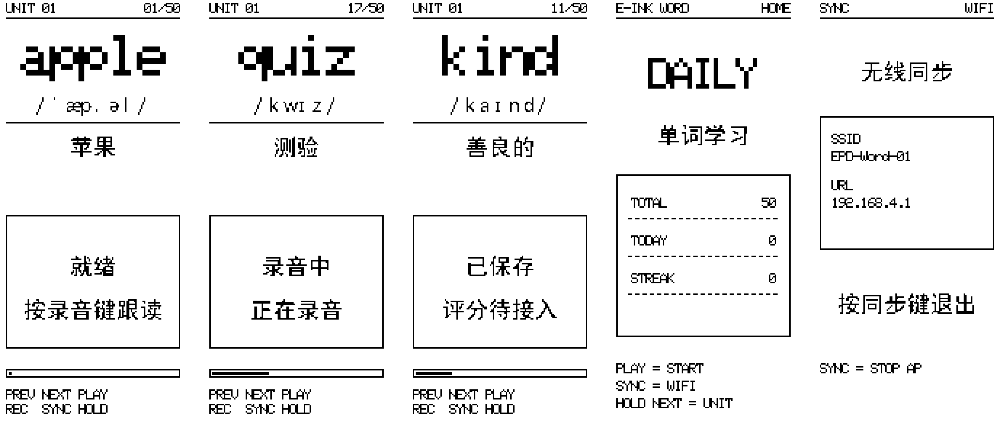

# 2.9" 单词卡界面（横向 296×128，二级菜单）

> 更新时间：2026-11-05
> 状态：已实机验证——菜单/单词/日历/同步/设置五页均可渲染，翻页局刷 469 ms。



## 1. 页面结构

```text
主菜单 ─┬─ 单词      翻词 / 录音 / 播放
        ├─ 复习日历  月历，已复习=黑底白字，今天=方框
        ├─ 同步      SSID / URL / Wi-Fi 状态
        └─ 设置      无线网络、蓝牙开关
```

| 页面 | 状态栏 | 主体 | 底部 |
| --- | --- | --- | --- |
| 主菜单 | `E-INK WORD` / `MENU` | 4 项，选中行反白（黑底白字） | — |
| 单词 | `UNIT 01` / `01/50` | 单词 ×4 + 音标与释义同一行 + 进度条 | 键位条 |
| 复习日历 | `CALENDAR` / `2026-11` | 星期表头 + 6×7 日格 | — |
| 同步 | `SYNC` / `WIFI OFF` | 无线同步标题 + SSID/URL | 提示 |
| 设置 | `SETTINGS` / `MENU` | 两项开关，选中项加框 | 提示 |

## 2. 按键

| 页面 | PREV / NEXT | PLAY | REC | SYNC |
| --- | --- | --- | --- | --- |
| 主菜单 | 上下选择 | 进入 | — | 直接进同步页 |
| 单词 | 上一个 / 下一个词 | 播放最近录音 | 录音 2 s | 返回主菜单 |
| 复习日历 | 上一月 / 下一月 | — | — | 返回主菜单 |
| 同步 | — | 返回 | — | 返回主菜单 |
| 设置 | 切换条目 | 开 / 关 | — | 返回主菜单 |

## 3. 布局常量

C 端在 [`main/ui29/ui29_card.c`](../main/ui29/ui29_card.c) 顶部，预览在
[`tools/ui29_preview.py`](../tools/ui29_preview.py) 顶部，**两处同名常量必须同步改**。

| 常量 | 值 | 含义 |
| --- | --- | --- |
| `MARGIN` | 3 | 左右留白 |
| `Y_SBAR` / `Y_DIV1` | 3 / 14 | 状态栏文字顶、分隔线 |
| `MENU_X` / `MENU_Y` / `MENU_ROW_H` | 12 / 18 / 26 | 菜单项起点与行距 |
| `Y_WORD` / `WORD_SCALE` | 18 / 4 | 单词顶、放大倍数（20×32 px） |
| `Y_ROW2` | 56 | 音标与释义同一行 |
| `Y_BAR` / `BAR_H` | 86 / 8 | 进度条 |
| `Y_HINT` | 106 | 键位条文字顶（条框 98–121） |
| `CAL_CELL_W` / `CAL_HDR_Y` / `CAL_Y0` / `CAL_ROW_H` | 41 / 15 / 41 / 14 | 日历格宽、表头顶、网格顶、行高 |

## 4. 字库（比上一版放大）

| 字库 | 字身 | 用途 | 体积 |
| --- | --- | --- | --- |
| `ui29_font24.h` | 24×24 汉字 | 菜单项、释义、设置项 | 126 字 |
| `ui29_font14.h` | 14×24 IPA | 音标行（与释义并排） | 36 字 |
| 5×7 ASCII | — | 状态栏、页码、键位提示、日历数字 | 驱动内置 |

字库是**按用到的字生成的子集**。改词表或文案后必须重跑：

```powershell
.\.venv-train\Scripts\python.exe tools\ui29_assets.py
.\.venv-train\Scripts\python.exe tools\ui29_preview.py
```

否则新字不会报错，而是直接不画（空白）。

## 5. 坐标映射（横屏）

SSD1680 的 gate 固定 296 行，横屏不是换分辨率，而是把内容旋转 90°：

```text
phys_x = 127 - ly      (128 列)
phys_y = lx            (296 行)
```

现场校正方向（不用重烧）：

```text
bench ui flip 0   # 正常
bench ui flip 1   # 上下翻
bench ui flip 2   # 左右翻
bench ui flip 3   # 都翻
```

## 6. 刷新策略

| 场景 | 方式 | 实测 |
| --- | --- | --- |
| 上电 / 强制重绘 | 全刷 0xF7 | 2023 ms |
| 翻页 / 换词 / 换月 | 整屏局刷 0xFF | 469 ms |
| 每 20 次局刷 | 插一次全刷 | 2023 ms |

## 7. 调试命令

```text
bench ui page 0..4     # 直接跳页（0=菜单 1=单词 2=日历 3=同步 4=设置）
bench ui flip 0..3     # 现场翻方向
bench epd1680 test     # 面板自检（全白/全黑/图案/局刷/整屏局刷）
```

## 8. 已知限制

| 项 | 现状 |
| --- | --- |
| 复习记录 | 只在 RAM（本次开机录音过就打点），重启清零；待接 NVS |
| 日历翻月 | 可跨年翻月；无“回到本月”快捷键 |
| Wi-Fi / 蓝牙 | 设置项只是状态位，未真正启停协议栈 |
| 评分 | 卡片页只显示 `SAVED` / `NO SPEECH`，评分待接规则法/TFLM |
| 长词 | 单词超过 6 字母时 ×4 会超出左栏，暂未做自动降级 |
